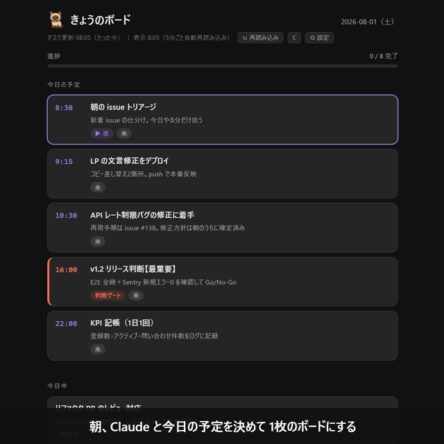
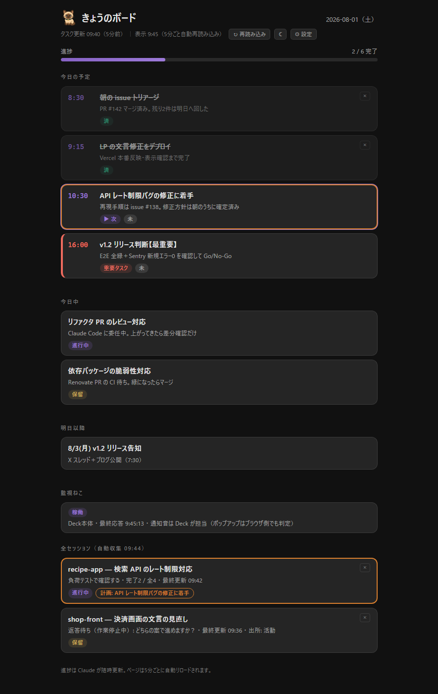
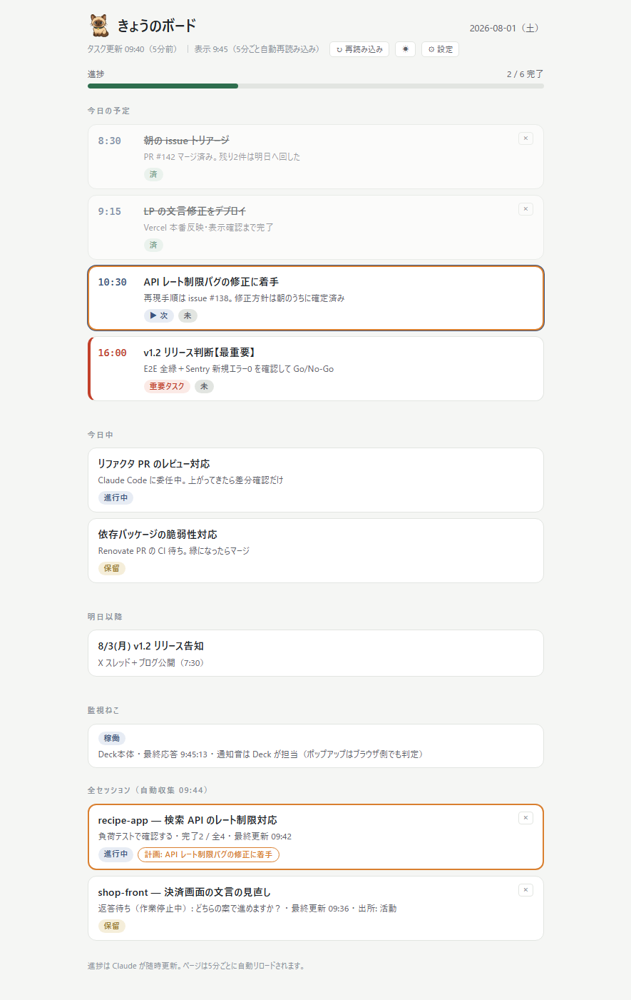
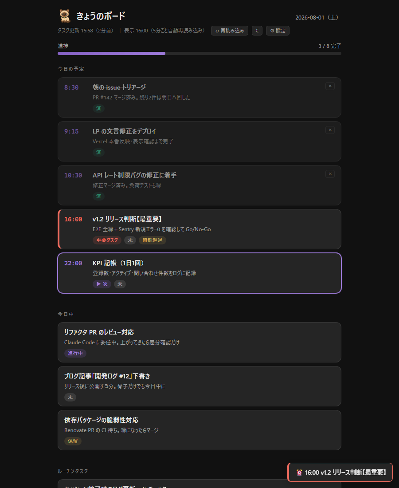
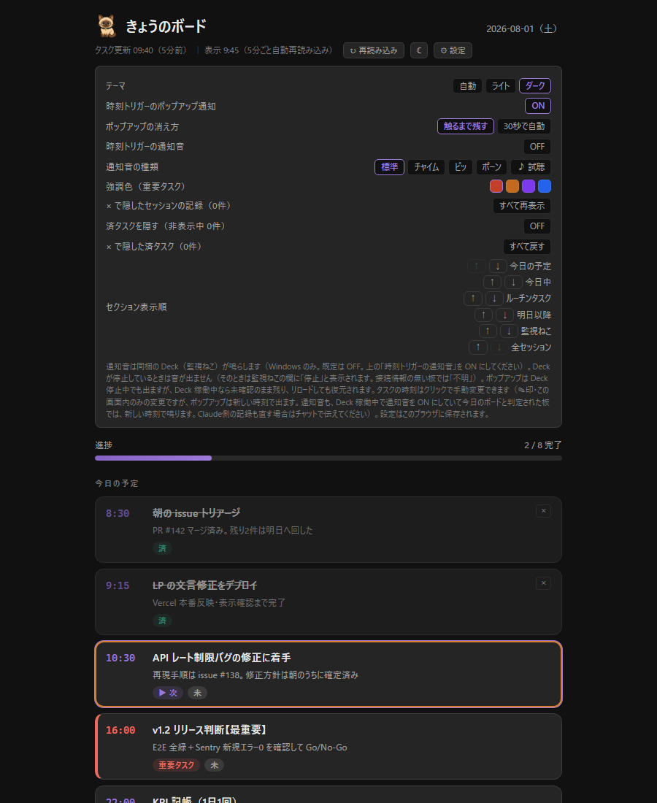

<div align="center">


# きょうのボード

**Claude Code が自分で更新する、今日のタスク管制盤**

ゼロAPI・Python と Claude Code を入れたら `setup.bat` をダブルクリック（スキル ＋ 全セッション自動集約ウォッチャー「Deck」）



</div>

## これは何？

朝、Claude Code と今日の予定を決めると、1枚のHTMLボードになります。
そのボードを隣の画面（サブモニタ・別ウィンドウ）に置いて作業すると、
タスクの完了・着手に合わせて **Claude が自分でボードを書き換えます**。

Claude Code に「進捗どう？」と聞いてチャットログを遡る代わりに、
隣の画面で勝手に育っていくボードを眺めるだけになります。

## 特徴

- **セットアップはダブルクリック1回** — `setup.bat` がスキルと Deck の配置・スタートアップ登録・起動まで済ませる（管理者権限なし・外部サーバーなし・ビルドなし・npm なし）
- **Claude 自身が更新** — ボードは普通のHTMLファイルで、Claude が同梱の専用スクリプト（`board_edit.py`）で読み書きする（書く前に形が崩れないかを確かめる）。ページは5分ごとに自動リロード
- **全セッション自動集約＋通知音（Deck）** — 並行セッションの状態（タスク一覧があれば進捗も）をボード下部に自動挿入し、時刻トリガーの通知音も鳴らす常駐ウォッチャーを同梱。セットアップで一緒に入り、以後は Windows のログオン時に起動する（Python 標準ライブラリのみ・単一ファイル・音は Windows のみ）
- **時刻トリガー通知** — 予定時刻になるとポップアップで知らせます（ポップアップは既定 ON）。**通知音は既定 OFF。⚙で ON にすると同梱の Deck が4種から選んだ音を鳴らします**
- **「▶ 次」自動ハイライト** — 次にやるタスクを現在時刻から自動で強調。過ぎたタスクには「時刻超過」チップ
- **重要タスク** — その日に特に重要なタスクを赤い左罫とチップで強調（色は変更可）
- **ライト / ダークテーマ・強調色・通知音の設定** — ボード上の⚙から。ブラウザ内に保存します（通知音の ON/OFF と音種は Deck にも送られ、`sound.json` に保存されます）
- **ゼロAPI** — 追加のAPIキー・外部サービスなし。**local モードではボードのファイルはローカルに置かれます**。ただし Claude がボードを作る・更新するときはボードの内容を読み書きするので、その内容はふだんの会話と同じく Claude（Anthropic の API）に送られます（artifact モードを自分で選んだ場合は、さらに claude.ai 上に発行されます＝下記 FAQ）

| ダーク | ライト |
|---|---|
|  |  |

| 時刻トリガー通知 | 設定パネル |
|---|---|
|  |  |

## インストール

**必要なもの**: Windows 11（10 は未検証）・Python 3・Claude Code（**有料のアカウントが要ります**）・Git for Windows（推奨）

`setup.bat` は管理者権限なしで動きます。Python（Python install manager）と Claude Code も、2026-10-26 に管理者でないアカウントで、
管理者の確認画面（UAC）なしに入ることを確認しました（1回の確認）。Git for Windows を管理者でないアカウントで入れられるかは確認していません。

進め方は2段です。**まず前提のソフト（Python →〔入れるなら Git for Windows〕→ Claude Code）を入れ、
次にきょうのボード本体を入れます（手順1〜3）。**  
以下で「確かめたとき」と書いているのは、2026-10-25〜26 に同じ PC の Windows 11 の別のアカウント（Python も Claude Code も
入っていない状態から入れたもの。10-26 には作り直した管理者でないアカウントでもう一度通しました（手順3 は手順の紙を併用））で入れたときの画面です
（版が変わると文面が変わることがあります）。

### １．準備: 前提のソフトを入れる（Python 3・Git for Windows・Claude Code）
既にお使いのPCにインストールされている場合は、再インストールは不要です。  
**２．きょうのボードを入れる**の節へ進んでください。

#### Python 3
 以下は**Python install manager**で入れる方法を紹介します。  
 （Python の公式ドキュメントが勧めている入れ方で、
  確かめたのもこちらです）。
  1. [python.org の Windows 向けページ](https://www.python.org/downloads/windows/)のいちばん上にある
     「Latest Python install manager - Python install manager 26.4」（番号は変わります）を開き、
     「Download Installer (MSIX)」を押します。そのページでは Microsoft Store から入れる方法が勧められていますが、
     ここでは「Download Installer (MSIX)」を使いました（Store で入れた場合にこの手順どおりに進むかは確認しておりません）。
  2. Edge では、ダウンロードの一覧に「python-manager-26.4.msix はデバイスに問題を起こす可能性があります。
     このまま保持しますか?」と出ることがあります。python.org から落としたものなら「保存」を押してください
  3. 落としたファイルを開くと「Python Install Manager をインストールしますか?」と出ます。
     「準備ができたら起動」にチェックが入ったまま「Python のインストール」を押します
  4. 入れ終わると黒い窓が開き、英語で順に質問されます。`[y/N]` は何も入力せず Enter なら N、
     `[Y/n]` は何も入力せず Enter なら Y です。確かめたときの質問と答え方:

     | 画面の質問 | 答え |
     |---|---|
     | `Update setting now? [y/N]`（260文字を超える長いパスを許すか。**出ないこともあります**——PC 全体の設定なので、許可済みの PC では出ないはずです。2026-10-26 の確認では出ず、最初の質問が次の行でした） | 何も入力せず Enter（N）。きょうのボードには要らないはずです（推定。2026-10-25 に確かめたときは y と答えました）。`y` にすると管理者の承認を求められることがあり、反映には再起動が要ります（画面の説明） |
     | `Add commands directory to your PATH now? [y/N]` | `y` と入力して Enter |
     | `Install CPython now? [Y/n]` | `Y` と入力して Enter（何も入力せず Enter でも同じ。これで Python 本体が入ります） |
     | `View online help? [y/N]` | 何も入力せず Enter（N）。そのあと窓が残っていれば閉じてかまいません |

     黒い窓が出なかった・途中で閉じてしまったときは、「ターミナル」（下の「Claude Code」の 1）を開いて `py install --configure` と入力して Enter を押すと
     同じ質問をやり直せます（python.org の説明による）
  - 同じページには従来のインストーラー（各版の「Windows installer (64-bit)」）も並んでいますが、Python 3.14 から
    非推奨で、3.16 からは作られません（Python の公式ドキュメント）。使う場合は最初の画面で「Add python.exe to PATH」に
    チェックを入れてください
#### Git for Windows（推奨・[入手先](https://git-scm.com/downloads/win)）  
インストール方法の詳細は、他のサイトをご参考にしてください。  
無くても Claude Code は動きますが
  （その場合は PowerShell でコマンドを実行します）、このスキルの手順の一部は Git に付いてくる bash の
  書き方を使用しており、Git の無い環境できょうのボードが最後まで動くか確認していないため、インストールを推奨します。
#### Claude Code
以下は、公式の[セットアップ手順](https://code.claude.com/docs/en/setup)のうち、Windows の PowerShell の入れ方を紹介します。
  **Pro / Max / Team / Enterprise か Console のアカウントが要ります**（無料プランでは使えません）。
  1. スタートメニューから「ターミナル」を開きます。PowerShell の窓（タブに「Windows PowerShell」と出ます）が開くので、
     次の1行を貼り付けて Enter を押します（「ターミナル」が見つからないときは、スタートメニューの検索欄に「ターミナル」と入力）:

     ```
     irm https://claude.ai/install.ps1 | iex
     ```

     最初に `Setting up Claude Code...` と出たあと、ダウンロードの間はしばらく何も表示されません。「Installation complete!」と出たら終わりです
  2. その上の `Setup notes:` に `Native installation exists but C:\Users\<名前>\.local\bin is not in your PATH.`
     と出た場合は、同じ窓で次の2行を、**1行ずつ貼り付けて、そのつど Enter** を押します（公式の
     [Verify your PATH](https://code.claude.com/docs/en/troubleshoot-install#verify-your-path) の手順で、
     ユーザーの PATH に `%USERPROFILE%\.local\bin` を追加します）:

     ```
     $currentPath = [Environment]::GetEnvironmentVariable('PATH', 'User')
     [Environment]::SetEnvironmentVariable('PATH', "$currentPath;$env:USERPROFILE\.local\bin", 'User')
     ```

  3. **開いていた窓を閉じて、「ターミナル」を新しく開き直し**、`claude --version` と入力して Enter を押します。  
    `2.1.310 (Claude Code)` のようにバージョン番号が出ればインストールが完了しています。（「認識されません」と出たら、上の 2 をやり直してから、新しい窓で再度3をやり直してください）
  - ログインは、下のきょうのボードの手順3 で初めて `claude` を起動したときに行います
  - デスクトップアプリの Claude Code でも使えますが、以下はターミナル（PowerShell）で使う方法を紹介しています。

### ２．きょうのボードを入れる（手順1〜3）

1. このリポジトリを取得して（`Code → Download ZIP` または `git clone`）、
   **ZIP を右クリック →「すべて展開」**（ZIP を開いた中から直接実行しない）。
   展開すると `today-board-main` フォルダが二重（`today-board-main\today-board-main\`）になることがあります。
   `setup.bat` が見えるところまで開いてください。
   - エクスプローラーの設定によっては拡張子（`.bat` など）が表示されず、`setup` という名前が2つ並びます
     （`uninstall` も同じ）。その場合は、Windows 11 ではエクスプローラーの上部の「表示」→「表示」→「ファイル名拡張子」にチェックを入れると拡張子が表示されます。
2. 展開したフォルダの中の **`setup.bat` をダブルクリックする**（管理者権限も、PowerShell の実行ポリシーの変更も要りません）
   - ダブルクリックしたとき「開いているファイル - セキュリティの警告」（発行元を確認できませんでした）が
     出ることがあります。インターネットから来たファイルを開くときに Windows が出す確認です。
     **このリポジトリ（GitHub の Jir0-hub/today-board）から落としたものであれば、「実行」を押して進めてください**
     （入手元が分からないファイルに対しては作成者は保証していないため、実行しないことを推奨します）。
   - 黒い窓に `[1/5]`〜`[5/5]` が順に出て、緑の「=== 完了 ===」が出れば終わりです。最後に
     `Press any key to continue . . .`と出たら、何かキーを押して窓を閉じてください
   - 「Python 3 が見つかりませんでした。」と出て止まったら、上の「Python 3」を入れてから、もう一度ダブルクリックしてください
3. Claude Code を起動して、**「今日のタスクをボードにして」** と言い（または `/today-board` と入力し）、続けて今日のタスクを箇条書きで送る
   - Claude Codeの起動は、Claude Code を入れたときと同じく、「ターミナル」（PowerShell の窓）で行います。どのフォルダで起動しても、
     ボードは同じ場所（`~/.claude/today-board/board.html`）に作られます。作業用のフォルダを1つ作って、そこで起動するのが
     おすすめです。  
     以降は、新しい作業フォルダを作成して、Claude Codeを起動する方法になります。  
     次の3行を**1行ずつ入力（または貼り付け）して、そのつど Enter** を押します（例。2回目からは `cd` の行から）:

     ```
     mkdir $HOME\work
     cd $HOME\work
     claude
     ```

     ホームフォルダ（`C:\Users\<名前>`）そのもので起動すると、下の「フォルダを信頼するか」の確認が起動のたびに出ます（公式の説明）
   - 初めて起動したときは、初期設定の案内が出るため、画面の案内に沿って進めます（バージョンによって変わることがあります）:
     - ①見た目の選択（`Choose the text style that looks best with your terminal`）——好みのものを選んで Enter
     - ②ログインの方法（`Select login method:`）——Pro / Max などのプランなら `1. Claude account with subscription` を選ぶ
     - ③ブラウザで「Claude Codeが Claude chat account への接続を求めています」が表示——「承認する」を押す
     - ④`Login successful. Press Enter to continue…`——Enter
     - ⑤`Security notes:`（Claude は間違えることがある・プロンプトインジェクションの注意表示）——読んで Enter
     - ⑥`Accessing workspace:`（このフォルダを信頼するか）——`Yes, I trust this folder` を選んで Enter
   - 起動した画面のいちばん下に `auto mode on` と出ていれば、確認の多くを Claude Code が自動で判断します
     （Claude Code 2.1.283 以降の既定）。それでも確認が出ることがあります。
     確認が出た場合は、何に対する確認かを見てください。  
     きょうのボードの作業——`~/.claude/skills/today-board/`・`~/.claude/today-board/` のファイルを読む・ボードを書き換える専用のスクリプトを `~/.claude/today-board/.guard/python.txt` に書かれた Python で実行する（`<その Python> ~/.claude/skills/today-board/scripts/board_edit.py <操作>` の形。PowerShell では `& $py "$env:USERPROFILE\.claude\skills\today-board\scripts\board_edit.py" <操作>`）・その操作の中身（JSON）を `~/.claude/today-board/ops/` に書く・表示モードの設定 `~/.claude/today-board/config.json`（初回だけ）と状態ファイル `~/.claude/today-board/state.json` を書く・日時を見る `date`（PowerShell では `Get-Date`）、ファイルの有無や中身を見る `Test-Path`・`Get-Content`、`python.txt` を読む `tr`（bash の場合）、ボードを開く `Start-Process` を実行する——なら Yes 側を選んでください（ボードとその設定は `~/.claude/today-board/` に置くためです）。それ以外の場所やコマンドへの確認なら、Yes にする必要はありません。
     Claude がボード（`board.html`）をこのスクリプトを通さずに書き換えようとしたとき（ファイルの置き換え `mv`・`Move-Item` などを含む）は、スキルに入っているボードの保護が止めるか、その操作が終わった時点で元に戻します（元に戻さずに、書き換えられたことを Claude に知らせるだけのことや、元に戻せずにそのことを Claude に知らせることもあります。元に戻す・知らせるのは、タスクの行・見出し・ヘッダの日付を書き換えたときと、タスクの行の入れ子や閉じ忘れ、Deck の目印の崩れ、未置換のプレースホルダが新しく出たとき、ボードのファイルを消したときです。DECK マーカーの間（Deck が書く部分）、ヘッダの進捗・更新時刻、タスクの行の外の `<div>` の数が合わなくなっただけの変更などは、戻しも知らせもしません（数が合わない板には、`board_edit.py` の行の追加や更新の操作は書き込みません。`restore` か `create` で直します））
   - 作業フォルダの外のファイルを初めて読むときは、4つの選択肢の確認が出ることがあります。
     `Yes, and keep allowing any reads outside the working directories`（以後は聞かずに読ませる）か
     `Yes, but ask again next time`（今回だけ読ませ、次もまた聞く）を選んでください。
     **`No, and block reads outside the working directories from now on` は選ばないでください**——以後すべてのセッションで
     作業フォルダの外が読めなくなる設定（`permissions.blockReadsOutsideWorkingDirectories`）が入り、ボードを作れなくなるおそれがあります（スキルはボードのファイルを読んで更新するため）。  
     選んでしまった場合は、ユーザーの設定ファイル（`~/.claude/settings.json`）から `permissions.blockReadsOutsideWorkingDirectories` の行を消し、Claude Code を起動し直してください。
   - 確認が出ないまま「止めた」という通知だけが出たときは、`/permissions` と入力し、「Recently denied」の一覧で
     その操作がきょうのボードの作業（上の一覧）なら、選んで `r` を押すと、確認つきでやり直せます（公式の説明）
   - 初回は表示モードを聞かれます。隣の画面に置いて使うなら **local** を選んでください。
     選択肢の一覧で出たら矢印キーで選んで Enter、文章で聞かれたら「local」と答えます。
   - 今日のタスクは、「今日のタスクをボードにして」（`/today-board` で始めた場合も同じ）に続けて箇条書きで送ってください
     （時刻のある予定は「14:00 定例MTG」のように）。**Enter を押すとその時点で送信されます。** 1つのメッセージの中で
     改行するには Shift+Enter（効かなければ Ctrl+J または Ctrl+Enter）を押してください。
     1件ずつ Enter で送ってもかまいません。
     途中で送られてしまったら、残りを続けて送ってください
   - タスクを聞かれたら、同じ形で答えてください。ボードが既定のブラウザで開きます。そのタブは開いたままにしておいてください

`setup.bat` がやること:

| # | 内容 |
|---|---|
| 1 | Python 3 の確認（無ければ入手先を案内して中断。勝手にインストールはしません） |
| 2 | スキルを `~/.claude/skills/today-board/` に配置（ボードが読む `board.css` / `board.js` / `cat.png` は `~/.claude/today-board/` にも置き、再実行時は毎回最新に更新します）。スキルのフォルダには、ボードを書き換える専用のスクリプト（`scripts/board_edit.py`）と、ボードの保護のフック（`hooks/`・`.claude-plugin/`）も入ります。フックの設定（`hooks/hooks.json`）は 1 で見つけた Python の場所を書き込んで作り、同じ場所を `~/.claude/today-board/.guard/python.txt` にも書きます。`~/.claude/today-board/.guard/format.json` は無いときだけ作ります |
| 3 | Deck を `~/.claude/today-board/deck/` に配置 |
| 4 | スタートアップにショートカットを登録（次回のログオン時に起動） |
| 5 | Deck を起動 |

- **何度実行しても安全です。** 2回目以降は「更新」として振る舞い、ボードのデータ
  （`board.html`・`state.json`・`config.json`・通知音の設定 `sound.json`）はそのまま残ります
  （`.guard/` も、書き直すのは `python.txt` だけで、ほかの中身には触れません）
- **`setup.bat` を実行したときに開いている Claude Code のセッションは、開き直すまでボードの保護が効きません。**
  Claude Code はスキルのフォルダをプラグインとして読み込み、そのフックをセッションの開始時に読み込むためです
- スキルと Deck は `~/.claude/` の下に写されるので、リポジトリから入手して展開したフォルダはセットアップ後に消しても動作に問題はありませんが、`uninstall.bat` を使うときと、`setup.bat` をもう一度実行するとき（すぐ下の項）にまた要ります
- **Python を入れ替えたりバージョンを上げたりした後に、Deck が起動しなくなったときや、Claude がボードを書けなくなったときは、`setup.bat` をもう一度実行してください。**
  スタートアップのショートカットと、ボードの保護のフックの設定（`hooks.json`・`.guard/python.txt`）が、セットアップした時点の Python の場所を指しているためです。その Python が無くなると、Claude はボードを書かなくなり、ボードの保護のフックも動かなくなることがあります。`setup.bat` はこれらを実行のたびに今の Python の場所で書き直します

## アンインストール

展開したフォルダ（`setup.bat` と同じ場所）の `uninstall.bat` をダブルクリック。常駐の停止・スタートアップ解除・スキルと Deck の削除を行います（スキルのフォルダごと消すので、`board_edit.py` とボードの保護のフックも消えます）。
`setup.bat` と同じ「開いているファイル - セキュリティの警告」が出たら、「実行」を押してください。

**ボードのデータを消すかどうかは実行時に聞かれます（既定は「残す」）。** 黒い窓に
「削除しますか？ [y = 削除 / それ以外 = 残す（既定）]:」と出たら、ボードのデータ（最後に作ったボード・日付の切り替えで残した前の日のボードと、形が崩れる前の版〔`history/`〕・通知音の設定・表示モード・ボードの保護の記録〔`.guard/`〕。
場所は `~/.claude/today-board/`）を**残すなら何も入力せず Enter**、**消すなら `y` と入力して Enter** です。
「=== 完了 ===」が出たら、`setup.bat` のときと同じく何かキーを押して窓を閉じてください。

- Python・Claude Code・Git for Windows は消しません（不要な場合は、それぞれを手動で消してください）
- データを残した場合、ボードはブラウザで開けますが、スキルと Deck を消すので、更新はされません
- 一時フォルダ（`%TEMP%\today-board-deck-locks\`）に、Deck が使っていた小さなファイルが1つ残ります

## Windows 以外

`setup.bat` と Deck の常駐は Windows 専用です。macOS / Linux では `skill/` の中身を
`~/.claude/skills/today-board/` に手でコピーすればボード本体は動く想定ですが、**未検証・無保証**です
（Deck は入らないので、全セッション自動集約と通知音は付きません。Deck は Windows 以外でも音を鳴らさずに動く作りですが、確認はしておりません）。

ボードの書き換えとボードの保護に Python 3 を使います。コピーした後、`setup.bat` の代わりに次を手で行います
（`/usr/bin/python3` は `command -v python3` で出た絶対パスに置き換えてください）:

```
python3 ~/.claude/skills/today-board/hooks/make_hooks.py --python /usr/bin/python3
mkdir -p ~/.claude/today-board/.guard
printf '%s' /usr/bin/python3 > ~/.claude/today-board/.guard/python.txt
```

1行目で `hooks/hooks.json` ができます。3行目の `python.txt` は、Claude がボードを書き換えるスクリプトを起動するときに読むファイルで、
**無いと Claude はボードを書きません**。中身は Python 3 の絶対パスを1行だけ（UTF-8・BOM なし・末尾の改行なし。上の `printf '%s'` はこの形で書きます）。
Python の場所が変わったら、1行目と3行目をやり直してください。Windows 以外で、このフック（Claude Code がスキルのフォルダをプラグインとして読み込んで登録するもの）が働くかは**未検証**です。

```
~/.claude/skills/today-board/
├── LICENSE
├── SKILL.md
├── .claude-plugin/
│   └── plugin.json
├── assets/
│   ├── board-template.html
│   ├── board.css
│   ├── board.js
│   └── cat.png
├── hooks/
│   ├── guard.py
│   ├── hooks.json            ← make_hooks.py が作る
│   ├── hooks.template.json
│   └── make_hooks.py
└── scripts/
    └── board_edit.py
```

## Deck について

複数の Claude Code セッションを並行で走らせていると、全セッションのカードが
ボード下部の「全セッション」欄に自動で並びます。進捗（完了N / 全M）が出るのは、Claude がタスク一覧の道具（TaskCreate 等、またはデスクトップアプリの計画一覧）を使ったセッションです。使っていないセッションには「作業中」「入力待ち」などの状態だけを出します（新しいモデルでは TaskCreate 等が既定で提供されません。環境変数 `CLAUDE_CODE_ENABLE_TODO_TOOLS=1` で戻せます）。時刻トリガーの通知音も Deck が鳴らします。
停止方法・詳細は [deck/README.md](deck/README.md) を参照してください。

Deck は Claude Code の transcript（内部形式）を読み取り専用で監視します。**外部ネットワーク通信はありません**（ボードのD&D移動・通知音の設定・✎ の時刻の上書き・通知の受け渡しのため、`127.0.0.1` 限定の受信ポートを1つだけ開きます。外部への送信はしません）。生存確認（`/ping`）などの一部を除き、Deck が起動ごとに作る合い言葉（あなたのボードのファイルに書き込まれます）を添えた要求だけを受け付けます。
内部形式依存のため Claude Code の更新で追随修正が必要になる可能性があります（読めなくなったファイルはボード上にエラーが表示されます。デスクトップアプリの計画一覧の形式が変わった場合は、エラーにならず状態だけの表示に戻ります）。

初回にボードの表示モードを聞かれます:

- **local** — 固定パスのHTMLをブラウザで開く。PC の隣画面に常時表示するならこちら。複数プロジェクトの統合もこちら
- **artifact** — claude.ai の Artifact URL で発行。スマホからも見たい人向け

## 動作環境

- **Claude Code**（CLI / デスクトップアプリ）のスキル機能を使います
- **Python 3**（ボードの書き換え〔`board_edit.py`〕・ボードの保護〔フック〕と、Deck の常駐に必要。`setup.bat` が有無を確認します）
- 動作確認済み: Windows 11（Python 3.12・作者の普段の利用）。
  加えて 2026-10-25 に、**Python も Claude Code も入っていない別の Windows アカウント**（名前は日本語）で、
  **`setup.bat` をダブルクリックして本来の場所へ入れる**ことも確認済です（Python 3.15.1〔Python install manager〕・Claude Code 2.1.310・Microsoft Edge）。
  この確認は、`setup.bat` がボードの保護の設定（`hooks.json`・`.guard/python.txt`）を作るようになる前の版で行ったものです。
  ボードの書き換え（`board_edit.py`）とボードの保護は、2026-10-30 に作者の PC のデスクトップアプリ（Python 3.10）で1回確かめました（このときは `setup.bat` を使わず、同じファイルを手で置きました。`setup.bat` から入れた状態・Claude Code の CLI・別のアカウントでは、まだ確かめていません）。
- `setup.bat` / `uninstall.bat` / Deck は Windows 専用です。macOS / Linux は無保証（AS IS）で、スキルの手動コピーのみ（OS 非依存の想定・未検証）。要望が多ければ対応を検討します
- ボードの表示は普通のブラウザで行います（DOM・`fetch`・`localStorage`・`sessionStorage` などブラウザ標準の機能だけを使い、外部のライブラリは使っていません）。
- 動作確認は Microsoft Edge で実施しております。ほかのブラウザでもブラウザ標準の機能だけで動く作りですが、表示や動きがおかしいときは Edge で開いてください

## しくみ

ボード本体（スキル）は `skill/` の下のファイル、Deck の本体は1ファイルです（起動用の `start-deck.bat` を同梱）。

- `skill/SKILL.md` — Claude への指示書（ボードの作り方・更新の仕方・やってはいけないこと）
- `skill/assets/board-template.html` — 約100行のテンプレ。Claude は今日のタスクを JSON（spec）にして渡すだけで、`board_edit.py` の create がこのテンプレから `~/.claude/today-board/board.html` を作る。行の追加・状態の切り替えなどの更新も `board_edit.py` の操作で行い、Claude は HTML を書かない
- `skill/assets/board.css` / `board.js` — 見た目と自動機能（次タスクのハイライト・通知の描画〔ポップアップの発火判定はブラウザ側でも常に走り、Deck 経由と同じキーなら二重に出ない〕・テーマ）。Claude はこの2つを編集しない（ボードを作るたびに `board_edit.py` の create がスキルから `~/.claude/today-board/` へ写すだけ。Deck が動いていれば、Deck も起動時と5分ごとに同じように写します）
- `skill/assets/cat.png` — ボード見出しの猫アイコン
- `skill/LICENSE` — ライセンスの文面（MIT。リポジトリ直下の `LICENSE` と同じもの）。ボードの動作には使いません
- `skill/scripts/board_edit.py` — `board.html` を書き換える専用のスクリプト（Python 3 標準ライブラリのみ）
- `skill/hooks/guard.py`・`hooks.template.json`・`make_hooks.py`、`skill/.claude-plugin/plugin.json` — ボードの保護のフック。`setup.bat` が `make_hooks.py` で `hooks.json` を作り、Claude Code がスキルのフォルダをプラグインとして読み込んで登録します。フックは `board.html`・`.guard/`・`history/` に書きます（ボードを元に戻す・戻す前の版を `history/` に残す・控えと記録を `.guard/` に置く）
- `deck/deck_watcher.py` — 全セッションの transcript を差分監視し、ボード下部の予約領域（DECKマーカー間）にセッションカード（状態と、タスク一覧があれば進捗）を書き込む常駐ウォッチャー。ボードのファイルのうち予約領域の外に触れるのは「D&D 移動の反映」「完了表示を済チップに合わせて揃える整合」「日付が変わったときの今日のボードへの切り替え」「引き継いだボードの印を、手書きの部分が変わったときに外すこと（印の無い板に残った指紋も片付ける。D&D の反映では印の指紋を書き直す）」「進捗・更新時刻などヘッダの値の計算し直し」「欠けた予約領域の目印の足し直し（目印が2つとも無いときだけ。Deck が書いた部分が空行だけを挟んでひと続きに残っていればそれを囲み、間に別の行があれば足さない。Deck が書いた部分が1つも無ければ、ボードの末尾（`<footer>`）が1か所に決まるときだけその前に足す）」だけで、タスクの文言は書き換えません（ボードのファイルの外では、前の日のボードと形が崩れる前の版を残す `history/`・ボードと同じフォルダの `state.json` の日付・`board.css` / `board.js` / `cat.png` の写し・ボードと同じフォルダの `.guard/`（ボードの手書き部分を書き換える前に残す書き込みの記録と、その形式の版を書いた `format.json`）と、`deck/` の `state.json`・`sound.json`・`watcher.log`、一時フォルダの多重起動防止のロックファイルに書きます）

進捗が変わるたびに Claude が `board_edit.py` でボードを書き換え、開きっぱなしのブラウザタブが自動リロードで追随します。
日付が変わると、Deck が前の日のボードを `~/.claude/today-board/history/` へ残し、終わっていないタスクを引き継いだ今日のボードを作ります。ボードのパスが毎日同じなので、local モードでは、**タブを開いたままにしておけば、翌日は自動で新しい日のボードに切り替わります**（Deck が止まっているときと artifact モードでは切り替わりません。Deck が動いていても、ボードの形が崩れているときなど、Deck が切り替えずにおくボードがあります。local モードでは、ヘッダの下に「書き込み停止中」と出ます。どの場合も、Claude に「今日のボードを作って」と頼んでください。artifact モードでこの知らせが出るかは確かめていません）。

### 自動で直るもの・Claude に頼るしかないもの

ボードの中身は Claude が `board_edit.py` の操作で書きます（`board_edit.py` は書くたびに進捗と更新時刻も数え直します）。進捗の数え直しと済みの表示は、ボードのスクリプトが画面の上で計算し直します。日付の切り替えと更新時刻は Deck が直すので、Deck が動いている local モードに限り、Claude が書き忘れても正しい値に戻ります（更新時刻は、Deck が動いている間にボードが書き換えられたときだけ直ります）。ボードが今日のものでないときは「書き込み停止中」、ボードの形が崩れているときは「ボードの点検」の知らせが、local モードではヘッダの下に出ます。見出しの名前が正式名に似ているのに正式名でないときも、「ボードの点検」の知らせが出ます（直しはしません）。Deck が動いている間にボードの形が崩れたときは、Deck が崩れる前の版を `history/` に残します（Deck は板を直しません。直すのは Claude か利用者になります）。Claude が `board_edit.py` を通さずにボードを書き換えようとしたときは、ボードの保護が止めるか、そのツールが終わった時点で元に戻します（戻す前の版は `history/board-<日付>-foreign-<時刻>.html` に残します。元に戻さずに、書き換えられたことを Claude に知らせるだけのことや、元に戻せずにそのことを Claude に知らせることもあります。元に戻す・知らせるのは、タスクの行・見出し・ヘッダの日付を書き換えたときと、タスクの行の入れ子や閉じ忘れ、Deck の目印の崩れ、未置換のプレースホルダが新しく出たとき、ボードのファイルを消したときです。DECK マーカーの間（Deck が書く部分）、ヘッダの進捗・更新時刻、タスクの行の外の `<div>` の数が合わなくなっただけの変更などは、戻しも知らせもしません（数が合わない板には、`board_edit.py` の行の追加や更新の操作は書き込みません。`restore` か `create` で直します））。

一方、**どのタスクが済んだか・何を今日やるかが正しいかは、機械には判断できません。** Claude が間違えた状態を書くと、そのまま表示されます。おかしいと思ったら、チャットで Claude に直すよう伝えてください。Deck を止めている場合や artifact モードでは、日付の切り替えも自動では行われないので、Claude に「今日のボードを作って」と頼んでください。

## よくある質問

**Q. タスクの内容はどこかに送信される？**  
A. ボードのファイル（`board.html` など）はローカルに置かれ、Deck も外部へは何も送りません。ただし、Claude がボードを作る・更新するときはボードの内容を読み書きするので、その内容は Claude Code の会話の一部として、ほかの会話と同じく Claude（Anthropic の API）に送られます。artifact モードを自分で選んだ場合は、さらに claude.ai 上に発行されます。

**Q. スキルって何？**  
A. スキルは Claude Code が状況に応じて読み込む Markdown の指示書で、フォルダを置くだけで有効になります。`setup.bat` はそのコピー（と Deck を `~/.claude/today-board/deck/` に置いて常駐させること）を代わりにやっているだけで、実行ファイルのインストールやレジストリの変更はしません（ファイルを写すほかに作るのは、スタートアップのショートカットと、ボードの保護の設定〔`hooks.json`・`.guard/` の `python.txt`・`format.json`〕だけ）。
このスキルのフォルダには、Claude Code がボードのファイルを専用のスクリプト（`board_edit.py`）を通さずに書き換えようとしたときに止める・元に戻す小さな Python スクリプト（フック）も入っていて、Claude Code はこのフォルダをプラグインとして読み込みます（`~/.claude/settings.json` は書き換えません）。

**Q. 複数プロジェクト・複数セッションでも使える？**  
A. 使えます。local モードでは全セッションが同じボードを、そのつど読み直して書き換えます（プロジェクトごとにセクションを分ける運用が SKILL.md に書いてあります）。さらに常駐している Deck が、各セッションの状態（タスク一覧があれば進捗も）を自動で1枚に集約します。

**Q. Deck だけ止めたい／消したい**  
A. 止めるだけならタスクマネージャーで `pythonw.exe`（コマンドラインに `deck_watcher.py` を含むもの）を終了します
（Python install manager で入れた場合は2つ並ぶことがあります。両方とも終了してください。作者の PC では、どちらか1つを終了するともう一方も終わりました）。
以後も自動起動させたくない場合は、スタートアップフォルダ（`Win+R` → `shell:startup`）の
`today-board-deck.lnk` を削除してください。ボード本体（スキル）はそのまま使えますが、**全セッションの自動集約と時刻トリガーの通知音は止まります**。

## 支援

役に立ったら:

- ⭐ このリポジトリにスターをつける
- ☕ [Ko-fi で支援する](https://ko-fi.com/jir0_dev)

支援していただいた方は、更新時の Special Thanks 欄でお名前を紹介します。

## 続報を受け取る

このツールの続報を受け取るには:

**[FolioInk でジローをフォロー](https://folioink.com/creators/jir0)**（無料登録・フォローすると新着記事がメールで届きます）

## License

MIT
